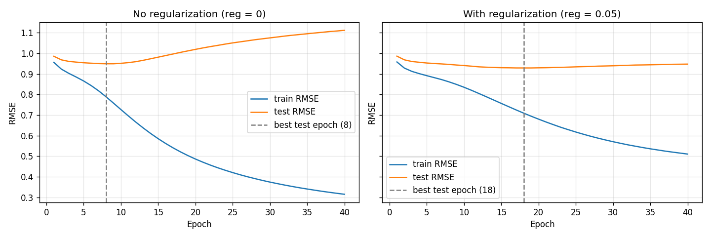
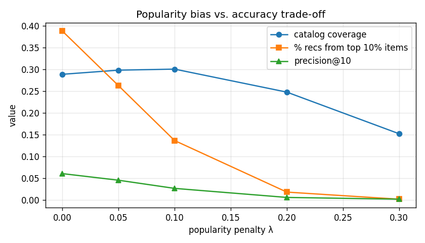

# Movie Recommender: Matrix Factorization, Overfitting and Popularity Bias

**Live app:** https://akshu-movie-recs.streamlit.app · **Full report:** https://akshu577.github.io/movielens-recommender/

I built a matrix factorization recommender from scratch with stochastic gradient descent (no recommender library) on MovieLens 100K: 100,000 ratings from 943 users on 1,682 movies. Then I looked at two problems real recommenders have, overfitting and popularity bias.

I did this as the experiments part of a case study for my MS in AI. The case study was about a music startup ("NextStar") that had no data yet, so I used MovieLens as a stand-in.

Everything is in [`recommender.ipynb`](recommender.ipynb).

## Results

**Rating prediction (80/20 split)**

| Model | Test RMSE | Test MAE |
|---|---|---|
| Baseline (always predict the average, 3.53) | 1.133 | 0.951 |
| Matrix factorization, no regularization | 1.112 | – |
| Matrix factorization, regularization = 0.05 | **0.948** | **0.743** |

Without regularization, training RMSE kept falling (to 0.32), but test RMSE bottomed out at epoch 8 and climbed back to 1.11, almost as bad as guessing. With regularization, the model is about 16% better than the baseline.



**Popularity bias.** The plain model took 38.8% of its top-10 recommendations from the 10% most-rated movies. I tried re-ranking with a penalty, `score − λ × log(1 + number of ratings)`:

| λ | precision@10 | catalog coverage | share from top-10% items |
|---|---|---|---|
| 0 | 0.060 | 28.9% | 38.8% |
| 0.05 | 0.045 | 29.8% | 26.3% |
| 0.2 | 0.006 | 24.8% | 1.8% |



A small penalty reduces the bias a lot. Too much just swaps one bias for another: everyone gets the same few obscure movies. Some of the precision drop probably comes from the offline test itself. People are more likely to have rated popular movies, so the test rewards recommending them. That's why you'd want an A/B test with real users before deciding.

## Run it

```bash
pip install numpy pandas matplotlib jupyter
jupyter notebook recommender.ipynb
```

The notebook downloads MovieLens 100K from GroupLens on the first run. The dataset's license doesn't allow redistribution, so it's not included in this repo.
